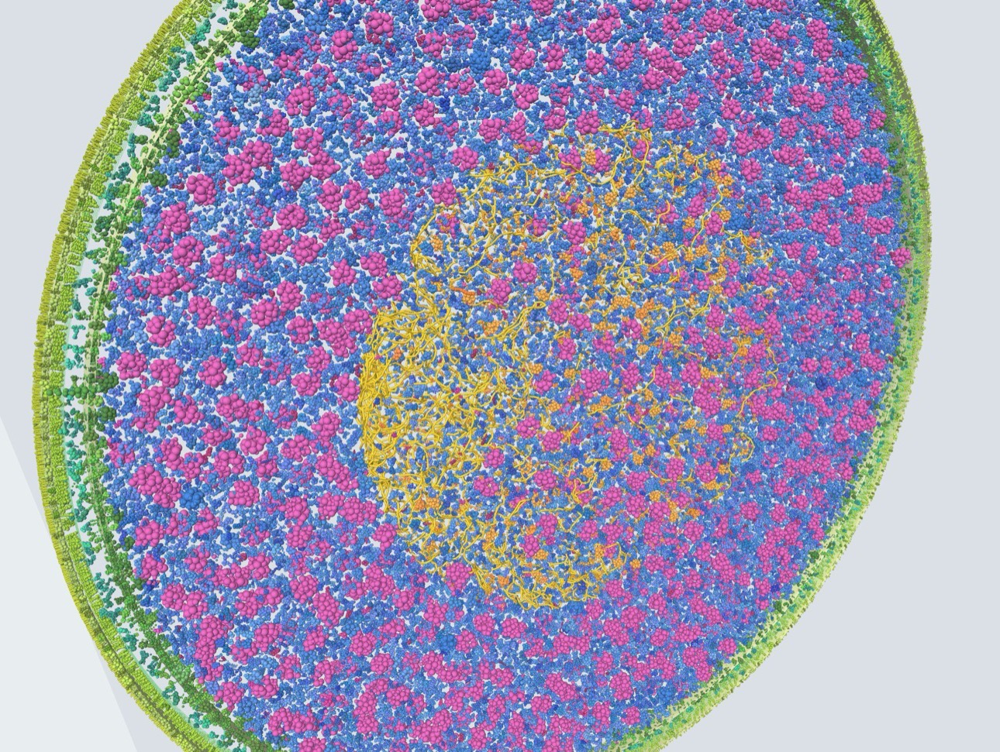

# Virtual *E. coli* K-12

A whole-cell, molecular-scale model of *Escherichia coli* K-12 MG1655 that you can explore in your browser.
A Python pipeline turns the proteome, measured copy numbers and 3D structures into coarse-grained
"ingredients"; a three.js viewer packs them into a slab through one fast-growing cell.



## Explore it online

| Page | What it does |
|---|---|
| **[Project home](https://emeritam.github.io/ecoli-vcell/)** | Overview, how the model is built and how to use it |
| **[Virtual cell viewer](https://emeritam.github.io/ecoli-vcell/viewer.html)** | Packs and renders the cell in 3D. Rotate, zoom, click molecules, search genes, toggle layers |
| **[Ingredient table](https://emeritam.github.io/ecoli-vcell/ingredients.html)** | Searchable list of all 3,494 ingredients with copy numbers, masses and a 3D shape preview |

Everything runs in the browser; nothing is installed or uploaded. The viewer works best on a desktop
browser with WebGL. Packing takes a few seconds; thicker slabs take longer.

### Using the viewer

- **Move around:** drag to rotate, scroll or pinch to zoom.
- **Identify a molecule:** click it. The info card shows its gene, location, mass, copies per cell, how
  many landed in this slab, and links to its PDB or AlphaFold structure.
- **Find a molecule:** type a gene or name (e.g. `groEL`, `ribosome`, `porin`), or open *All ingredients*.
- **Layers:** show or hide membranes, LPS, peptidoglycan, each compartment, ribosomes and DNA.
- **Cell and slab:** change cell width and slab thickness (10 to 80 nm), colour by compartment or by
  structure source, and press **Re-pack** for a new random arrangement.
- **Your own data:** **Load ingredients.json** packs a cell from any `output/ingredients.json` the
  pipeline produces. The file is read locally and never leaves your computer.

## What's in the model

Built from `ecoli-vcell-data-0.1.1/output/ingredients.json` (generated 2026-11-05):

- **3,494 ingredients**: 3,467 single proteins and 27 curated assemblies (70S ribosome, ATP synthase,
  complex I, RNA polymerase, GroEL/ES and others).
- **Compartments:** cytoplasm, nucleoid, inner membrane, periplasm, outer membrane, extracellular.
- **Structures:** 1,506 from the PDB, 1,988 AlphaFold DB models.
- **Shapes:** each molecule is a cluster of spheres (about one per 12 residues, at most 80),
  the multi-sphere representation used for collision tests in packing.
- **Envelope and DNA** are drawn by the viewer: lipid bilayers, LPS, peptidoglycan, and the chromosome
  as a confined semiflexible chain (about 3 genome equivalents, as in fast growth).

## Repository layout

```
.
├── index.html                    Project home page (GitHub Pages)
├── viewer.html                   Virtual cell viewer (v0.5, data embedded)
├── ingredients.html              Ingredient table + per-molecule 3D preview
├── assets/                       Images for the site and README
├── Virtual E. coli K-12 (v0.5).html / .md   Original v0.5 viewer and its notes
├── ecoli-vcell-data-0.1.1/       Data pipeline (current)
│   ├── step1_fetch_proteome.py … step5_coarse_grain.py
│   ├── run_all.sh, common.py, requirements.txt, README.md
│   ├── data/                     Proteome, abundances, chosen structures, curated assemblies
│   └── output/                   ingredients.json, ingredients_summary.csv, one JSON per ingredient
└── versions/                     Earlier pipeline versions (0.1.0–0.1.6), v0.1 notes (PDF)
```

Large regenerable downloads (`structures/`, `cache/`) and Python virtual environments are not in the
repository; the pipeline recreates them.

## Run the pipeline

Requires Python 3.9+ and about 1–3 GB of disk for structure files.

```bash
cd ecoli-vcell-data-0.1.1
python -m venv venv && source venv/bin/activate
pip install -r requirements.txt
./run_all.sh li2014_tableS1.xlsx --value-col "MOPS complete" --skiprows 1
```

Set `TOP=500` in front of `./run_all.sh` to limit structure picking to the 500 proteins carrying the
most mass; this gives a realistic-looking cell quickly.

| Step | Script | Produces |
|---|---|---|
| 1 | `step1_fetch_proteome.py` | `data/proteome.csv`: ~4,400 proteins with gene, b-number, mass, compartment (UniProt UP000000625) |
| 2 | `step2_add_abundance.py FILE` | `data/proteins.csv`: copies per cell from Li et al. 2014 or PaxDb |
| 3 | `step3_pick_structures.py` | `data/structures.csv`: one PDB entry or AlphaFold model per ingredient |
| 4 | `step4_download_structures.py` | `structures/*.cif(.gz)` |
| 5 | `step5_coarse_grain.py` | `output/ingredients.json` and `output/ingredients_summary.csv` |

To view your new output, open the [viewer](https://emeritam.github.io/ecoli-vcell/viewer.html) and use
**Load ingredients.json**. Details on every step, the abundance files and the output format are in
[`ecoli-vcell-data-0.1.1/README.md`](ecoli-vcell-data-0.1.1/README.md).

## Known gaps

- AlphaFold models are monomers, so proteins without an experimental structure lose their oligomeric state.
- Assemblies built from another species' PDB entry have no *E. coli* UniProt mapping; their stoichiometry is assumed to be 1.
- mRNA, tRNA, lipids as individual molecules, and metabolites are not yet included.
- PDB biological assembly 1 is occasionally not the physiological state; large complexes are worth spot-checking.
- Copy numbers from synthesis rates (Li et al. 2014) give a higher total protein mass than typical
  estimates for a single cell; treat absolute totals with care.

## How to cite

If you use this model, the viewer or the pipeline in your work, please cite it.
GitHub's **Cite this repository** button (sidebar) generates these automatically from
[`CITATION.cff`](CITATION.cff).

**APA**

> Mendoza Rengifo, E. (2026). *Virtual E. coli K-12: a browser-based whole-cell molecular model* (Version 0.5) [Computer software]. GitHub. https://github.com/emeritam/ecoli-vcell

**ACS**

> Mendoza Rengifo, E. *Virtual E. coli K-12: a Browser-Based Whole-Cell Molecular Model*, version 0.5; 2026. https://github.com/emeritam/ecoli-vcell (accessed YYYY-MM-DD).

**Nature / Vancouver**

> Mendoza Rengifo, E. Virtual E. coli K-12: a browser-based whole-cell molecular model. Version 0.5 (2026). https://github.com/emeritam/ecoli-vcell

**BibTeX**

```bibtex
@software{mendozarengifo_ecolivcell_2026,
  author  = {Mendoza Rengifo, Emerita},
  title   = {Virtual {E}. coli {K}-12: a browser-based whole-cell molecular model},
  version = {0.5},
  year    = {2026},
  url     = {https://github.com/emeritam/ecoli-vcell},
  note    = {ORCID: 0000-0001-5676-1472}
}
```

Please also cite the underlying resources this model is built from — UniProt,
Li et al. (2014), the PDB and AlphaFold DB — listed under [Data sources](#data-sources).

## Data sources

- [UniProt](https://www.uniprot.org/proteomes/UP000000625) reference proteome UP000000625 (*E. coli* K-12 MG1655)
- Li, Burkhardt, Gross & Weissman (2014), *Quantifying absolute protein synthesis rates reveals principles underlying allocation of cellular resources*, Cell 157:624–635, [doi:10.1016/j.cell.2014.02.033](https://doi.org/10.1016/j.cell.2014.02.033)
- [PaxDb](https://pax-db.org) protein abundances (optional alternative)
- [RCSB PDB](https://www.rcsb.org) and [PDBe](https://www.ebi.ac.uk/pdbe/) experimental structures
- [AlphaFold DB](https://alphafold.ebi.ac.uk) predicted structures
- Rendering with [three.js](https://threejs.org)
